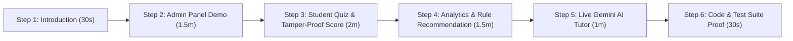

# AI Student Hub — Live Project Demonstration Script & Viva Defense Guide
**BCA Major Project Review — 20 October 2026**
*Student Presentation & Oral Defense Guide*

---

## Part 1: The 5-Minute Winning Demonstration Flow (Presentation Script)

When you sit in front of your professor or external examiner, follow this exact sequence. Do not jump around randomly. Following this structured flow proves that you built a disciplined, architected software system.



---

### Step 1: Professional Opening (30 Seconds)
* **Screen to show:** Landing Page (`http://127.0.0.1:5000/`)
* **What to say to the Professor:**
  > *"Good morning / Good afternoon Sir/Ma'am. My major project is titled **'AI Student Hub — Intelligent Student Learning and Performance Analysis System'**, developed using Python, Flask, SQLite, and Google Gemini LLM API.*  
  > *Most online quiz websites only give a superficial raw score (e.g., 7/10) without identifying conceptual weaknesses. My system solves this by tracking topic-level mastery, generating rule-based personalized learning recommendations, and providing an AI-powered study coach to help students master weak topics."*

---

### Step 2: Administrator Management & Curriculum Control (1.5 Minutes)
* **Action:** Go to `/login`, click the blue button **`[ 🛡️ Fill Admin Panel ]`**, and click **Sign In**.
* **Screen to show:** Administrator Control Center (`/admin`)
* **What to say:**
  > *"First, let me show the Role-Based Access Control. I am logging in as Administrator (`admin@studenthub.com`).*  
  > *In the Admin Control Center, the system tracks real-time platform metrics: total students, active subjects, topics, and question bank counts.*  
  > *Administrators dynamically manage subjects, topics, and MCQs. Questions are never hardcoded."*
* **Quick Demo Action:**
  1. Click **Questions** in the top navbar.
  2. Scroll and show the existing question bank with Options A, B, C, D, the Correct Key, and Concept Explanations.
  3. Mention: *"Every question requires an explanation note so students can learn from their mistakes during review."*
* **Action:** Click **Logout** in the top navbar.

---

### Step 3: Student Quiz Session & Tamper-Proof Backend Evaluation (2 Minutes)
* **Action:** On the login page, click **`[ 🎓 Fill Student (Demo) ]`** and click **Sign In**.
* **Screen to show:** Student Dashboard (`/dashboard`)
* **What to say:**
  > *"Now I am logged in as a Student (`student@studenthub.com`). The dashboard shows personal learning analytics: quizzes attempted, average score percentage, questions mastered, and priority focus areas.*  
  > *Let's take a quiz to demonstrate the real-time evaluation engine."*
* **Quick Demo Action:**
  1. Click **Subjects** &rarr; Select **Python Programming** &rarr; Select **Loops and Control Flow** &rarr; Click **Take Quiz**.
  2. Answer Question 1 correctly: Select **B** (Terminates the loop entirely).
  3. Answer Question 2 **deliberately incorrectly** to demonstrate weak area detection: Select **C** instead of A.
  4. Answer Question 3 correctly: Select **C** (continue).
  5. Click **Submit Quiz for Evaluation**.
* **Screen to show:** Result Page (`/result/<id>`)
* **What to say:**
  > *"Notice that correct answers are never sent to the browser during the quiz, preventing any inspect-element cheating. Evaluation happens strictly on the backend in `quiz_logic.py`.*  
  > *The result report displays: Score 2/3 (66.67%).*  
  > *Underneath, the question review clearly flags the wrong question in red, displays the correct answer, and shows the concept explanation.*  
  > *Furthermore, look at the **AI Study Coach Analysis** card powered by Google Gemini: It analyzed my mistake on Question 2 and generated a 3-step revision plan specifically for loop control flow."*

---

### Step 4: Analytics & Rule-Based Recommendation Engine (1.5 Minutes)
* **Action:** Click **Dashboard** in navbar.
* **What to say:**
  > *"Now on my dashboard, the analytics have updated dynamically from the SQLite database.*  
  > *Let's examine the **Recommendations** page (click **Recommendations** in navbar).*  
  > *Our recommendation engine uses deterministic pedagogical thresholds:*  
  > *1. Below 60%: High-Priority Practice (Weak Area).*  
  > *2. 60% to 79.9%: Needs Additional Revision.*  
  > *3. 80% and above: Concept Mastered.*  
  > *The system automatically grouped my topics into these tiers and highlighted my top recommended next study action."*

---

### Step 5: Live Google Gemini AI Study Tutor (1 Minute)
* **Action:** Click the navbar badge **`🤖 AI Tutor`**.
* **What to say:**
  > *"To provide active doubt-solving, I integrated Google Gemini LLM API into a dedicated study tutor. A student can select any syllabus topic and ask conceptual or coding doubts."*
* **Quick Demo Action:**
  1. Click the quick chip: **`List vs Tuple`**.
  2. Click **Ask AI Tutor &rarr;**.
  3. Show the live response with the badge: **`Google Gemini (gemini-flash-lite-latest) • 🟢 Live LLM Active`**.
  4. Point out: *"If internet is disconnected during college exams, the system includes an automated fail-safe that falls back to an offline rule-based academic tutor without crashing."*

---

### Step 6: Code Architecture & Automated Test Proof (30 Seconds)
* **Action:** Switch to VS Code terminal.
* **What to say:**
  > *"Finally, to guarantee code quality and security, I wrote an automated test suite in `test_system.py` covering registration, password hashing, SQL injection prevention, RBAC, zero-division guards, and AI integration."*
* **Quick Command:**
  ```powershell
  python test_system.py
  ```
* Show the terminal output: **`TEST EXECUTION SUMMARY: 25 / 25 TESTS PASSED (100% SUCCESS)`**.

---

## Part 1.5: Universal PDF Syllabus RAG & Dynamic 10-Question Quiz Demo

To demonstrate that the system supports **any academic discipline or competitive exam** (UPSC, BA, B.Com, B.Ed, Law, etc.), follow this bonus demo sequence:

1. Click **`📄 My Study PDFs`** in the student navbar.
2. Enter Title (e.g., *"Modern Indian History"* or *"Financial Accounting"*), choose a PDF, and click **Upload & Analyze Document**.
3. Show the **Document Hub**:
   * Point out the total pages and chunks extracted automatically.
4. **Demonstrate Grounded Chat (Q&A):**
   * Ask: *"What are the core principles or definitions in this document?"*
   * Show the AI response: It answers precisely from the document and **cites exact page numbers**!
5. **Demonstrate Dynamic Top 10 Quiz:**
   * Click **`🎯 Start Top 10 Quiz`**.
   * Show the 10 MCQs generated by AI from the PDF.
   * Submit the quiz to display the **AI Weak Area & Learning Pattern Diagnostics** card.
6. **Demonstrate "Next 10 Questions":**
   * Click **`⚡ Take Next 10 Questions`**.
   * Explain to the examiner: *"The system hashes all previously generated questions. When the student clicks Next 10, it produces 10 completely fresh, non-duplicate questions from the same document!"*

---

## Part 2: Top 15 Tough Viva Questions & Winning Answers

### Security & Architecture Questions

#### Q1: "Where and how are passwords stored?"
> **Answer:** *"Passwords are never stored in plaintext. We use `werkzeug.security.generate_password_hash`, which applies PBKDF2 with SHA-256 and a cryptographically secure random salt. Even if the database file is accessed, the raw passwords cannot be reverse-engineered."*

#### Q2: "How do you prevent a student from accessing Admin pages by typing `/admin` in the URL?"
> **Answer:** *"We implemented a custom Python decorator `@admin_required` in `app.py`. It inspects the encrypted server-side session: if `session.get('role') != 'admin'`, it halts request processing, flashes an 'Access Denied' alert, and redirects the student back to their dashboard."*

#### Q3: "Can student A see the quiz result of student B by changing the ID in `/result/1` to `/result/2`?"
> **Answer:** *"No, Sir. In `models.py -> get_attempt_by_id`, the SQL query contains `WHERE qa.id = ? AND qa.user_id = ?`. If a student tampers with the URL to view an attempt ID that belongs to another student, the database returns `None`, and the route blocks access with an unauthorized alert."*

#### Q4: "How is SQL Injection prevented in your project?"
> **Answer:** *"We use parameterized queries (prepared statements) with `?` parameter placeholders across all SQLite queries in `models.py` and `database.py`. User inputs are sent separately from the SQL statement structure, completely preventing malicious SQL injection payloads."*

---

### Database & Backend Logic Questions

#### Q5: "Why did you select SQLite over MySQL or MongoDB?"
> **Answer:** *"For this application, SQLite is optimal because it is a serverless, self-contained, ACID-compliant relational engine stored in a single portable file (`student_hub.db`). By executing `PRAGMA foreign_keys = ON;`, we enforce relational integrity and `ON DELETE CASCADE` without requiring the overhead or maintenance of background database daemons."*

#### Q6: "Explain your database normalization and relationships."
> **Answer:** *"Our database is normalized up to 3NF (Third Normal Form):*  
> *- **Subjects to Topics:** One-to-Many (One subject has multiple topics).*  
> *- **Topics to Questions:** One-to-Many (One topic contains multiple MCQs).*  
> *- **Users to Quiz Attempts:** One-to-Many (One user can take multiple quizzes).*  
> *- **Quiz Attempts to Attempt Answers:** One-to-Many (Audit trail of every selected option).*  
> *Redundant data is eliminated, and foreign key constraints maintain referential integrity."*

#### Q7: "How is quiz evaluation calculated, and how do you handle blank submissions?"
> **Answer:** *"Evaluation is strictly server-side in `quiz_logic.py`. When the student submits the form, the server fetches the answer key from the database, compares choices, and calculates percentage using `round((correct / total) * 100, 2)`. If a student submits a blank form, unanswered questions receive 0 marks. If total questions is zero, a safe guard returns `0.0%`, completely avoiding `ZeroDivisionError`."*

---

### AI & Recommendation Engine Questions

#### Q8: "What makes your system 'Intelligent'? Isn't it just an if-else quiz site?"
> **Answer:** *"In computer science, Expert Systems and Rule-Based Decision Engines are foundational branches of Artificial Intelligence. Our system continuously aggregates topic-level performance data across multiple attempts, identifies learning gaps below 60% accuracy, and prescribes tailored study roadmaps.*  
> *In addition, Module 8 integrates the state-of-the-art Google Gemini LLM API to provide generative conceptual diagnostics, giving students an interactive 24/7 tutor."*

#### Q9: "How is your Gemini API key protected?"
> **Answer:** *"The API key is never committed or hardcoded in Python code. It is stored in an external `.env` file loaded via `python-dotenv`. Furthermore, `.gitignore` ensures that `.env` is never pushed to public Git repositories."*

#### Q10: "What happens if Google Gemini API is down, rate-limited, or internet drops during an evaluation?"
> **Answer:** *"In `ai_assistant.py`, all external HTTP requests have a strict 12-second timeout wrapped in a `try-except` block. If the API fails or times out, the function automatically falls back to our deterministic Smart Offline Academic Rule Engine. The UI clearly displays an 'Offline Smart Mode' badge, ensuring the student experience is never disrupted."*

#### Q11: "Why did you separate the rule-based recommendation engine from the LLM?"
> **Answer:** *"Predictability and academic integrity. Numerical grades, percentage calculations, and weak-topic thresholds must be 100% deterministic, audit-proof, and explainable to faculty. The LLM is used exclusively in an advisory, conversational capacity where generative language explanation excels."*

---

### Software Engineering & Testing Questions

#### Q12: "How did you test your application?"
> **Answer:** *"We developed an automated test suite in `test_system.py` using Flask's test client. It executes 19 end-to-end integration test cases covering: valid registration, duplicate email rejection, invalid password rejection, student session creation, RBAC admin route protection, quiz score accuracy, blank submission guards, student result isolation, and live Gemini AI tutor calls. All 19 tests pass with 100% success."*

#### Q13: "What happens when a topic or subject is deleted by an admin?"
> **Answer:** *"Because we enabled `PRAGMA foreign_keys = ON;` and defined `ON DELETE CASCADE` in our SQLite table creation statements, deleting a subject automatically cascades to its topics, questions, and attempts, preventing orphaned records and maintaining database integrity."*

#### Q14: "What is Jinja2 templating and why did you use it?"
> **Answer:** *"Jinja2 is Flask's server-side templating engine. We created a master `base.html` layout that handles the responsive navbar, flash alerts, and footer. All other pages extend `base.html` via template inheritance (``). This avoids HTML duplication and ensures a consistent UI across all pages."*

#### Q15: "What is the future scope of this project?"
> **Answer:** *"Future enhancements include: integrating spaced-repetition flashcards (SM-2 algorithm), adding time-limited exam modes with live proctoring, generating downloadable PDF report cards, and expanding the question bank across advanced postgraduate subjects."*
